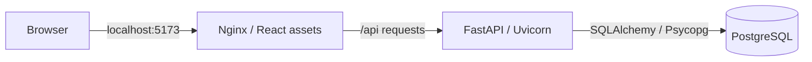

# KGRI Participant Portal: step-by-step build documentation

Documented on **16 November 2026** from the implemented source in this repository.

Updated on **17 November 2026** with Admin account editing, activation controls and presentation materials.

This guide explains how the portal was assembled, what each layer does, and how to reproduce and check the build. The steps follow the dependencies between components, making them a reading and reconstruction sequence. Commands run from the repository root unless a different directory is shown.

The implementation manages participant registration and consent, sample and sequencing tracking, phenotype measurements, CSV exports, staff authentication, and audit history. Demo records are synthetic. The current delivery is a local assessment application; production deployment and research governance work remain separate tasks.

## Build sequence

1. [Define the scope and permissions](#1-define-the-scope-and-permissions)
2. [Design the seven-table data model](#2-design-the-seven-table-data-model)
3. [Create the project structure](#3-create-the-project-structure)
4. [Declare dependencies and local configuration](#4-declare-dependencies-and-local-configuration)
5. [Establish PostgreSQL and API health checks](#5-establish-postgresql-and-api-health-checks)
6. [Implement models and database migrations](#6-implement-models-and-database-migrations)
7. [Add request sessions and consistent errors](#7-add-request-sessions-and-consistent-errors)
8. [Build authentication and authorization](#8-build-authentication-and-authorization)
9. [Build transactional audit logging](#9-build-transactional-audit-logging)
10. [Implement participant registration and consent](#10-implement-participant-registration-and-consent)
11. [Implement sample and sequencing tracking](#11-implement-sample-and-sequencing-tracking)
12. [Implement phenotypes and CSV export](#12-implement-phenotypes-and-csv-export)
13. [Create the synthetic seed](#13-create-the-synthetic-seed)
14. [Build the React application and API client](#14-build-the-react-application-and-api-client)
15. [Build the screens and shared controls](#15-build-the-screens-and-shared-controls)
16. [Package the application with Docker and Nginx](#16-package-the-application-with-docker-and-nginx)
17. [Build the automated checks](#17-build-the-automated-checks)
18. [Add continuous integration](#18-add-continuous-integration)
19. [Reproduce the local build](#19-reproduce-the-local-build)
20. [Trace a complete request](#20-trace-a-complete-request)
21. [Review the evidence and remaining work](#21-review-the-evidence-and-remaining-work)

## 1. Define the scope and permissions

The project was divided into three domain modules, supported by accounts and auditing.

| Area | Resulting capability |
| --- | --- |
| Participants | Register a person, find their record, edit demographics, record consent and archive a record |
| Samples | Link a specimen to a participant, maintain sequencing metadata and advance its lifecycle |
| Phenotypes | Capture study measurements, correct records and export a study CSV |
| Accounts | Sign in staff, identify the current user and let administrators create accounts |
| Audit | Preserve actor, action, entity and before/after changes for domain mutations |

The permission matrix was established before wiring the forms and routes:

| Operation | Admin | Lab technician | Field officer |
| --- | --- | --- | --- |
| Read participants and consent | Yes | Yes | Yes |
| Create/edit participants and consent | Yes | No | Yes |
| Archive participants | Yes | No | No |
| Read samples and summaries | Yes | Yes | Yes |
| Create/edit/advance/archive samples | Yes | Yes | No |
| Read/create/edit phenotypes and export CSV | Yes | No | Yes |
| Archive phenotypes | Yes | No | No |
| Create/edit/deactivate/reactivate accounts and read audit events | Yes | No | No |

This matrix drives both backend permission dependencies and frontend navigation. The backend checks every protected request independently.

**Read:** [README.md](README.md), [DECISIONS.md](DECISIONS.md).

## 2. Design the seven-table data model

The selected ER model was translated into seven PostgreSQL tables after the model sign-off recorded in the project documentation.

| Model / table | Purpose and relationships |
| --- | --- |
| `User` / `users` | Staff identity, password hash, role and active flag; referenced by creator, capture and audit fields |
| `Participant` / `participants` | Demographics, generated KGRI identifier, creator and lifecycle timestamps |
| `ParticipantConsent` / `participant_consents` | Current broad research, recontact and data-sharing choices; `participant_id` is both primary key and foreign key |
| `Sample` / `samples` | Many samples can belong to a participant; stores type, state and sequencing metadata |
| `Study` / `studies` | Study code and name; one study can have many phenotype records |
| `PhenotypeRecord` / `phenotype_records` | Links participant, study and capturing user to one measurement capture |
| `AuditEvent` / `audit_events` | Links an actor to an affected entity type and ID, with the changed fields |

The shared key on `participant_consents` permits at most one consent row per participant. The registration transaction creates the participant and its consent row together. Each sample and phenotype record references an existing participant. Each phenotype also references an existing study and capturing user.

An audit event identifies its affected record through `entity_type` and `entity_id`. That pair is an application-managed reference; targets can be participants, samples, phenotype records or user accounts.

The design also established soft deletion through `deleted_at`, restricted foreign-key deletion, UTC timestamps, range checks and indexes for common lookups.

**Read:** [docs/er-diagram.md](docs/er-diagram.md), [backend/config/models.py](backend/config/models.py).

## 3. Create the project structure

The scaffold separates the web interface, API, database history and project documentation:

```text
.
├── backend/
│   ├── apps/
│   │   ├── accounts/
│   │   ├── audit/
│   │   ├── participants/
│   │   ├── phenotypes/
│   │   ├── samples/
│   │   └── seed.py
│   ├── config/
│   │   ├── database.py
│   │   ├── main.py
│   │   └── models.py
│   ├── migrations/
│   ├── tests/
│   └── Dockerfile
├── frontend/
│   ├── src/
│   ├── Dockerfile
│   └── nginx.conf
├── database/schema.sql
├── docs/
├── scripts/init_env.py
├── .github/workflows/ci.yml
├── docker-compose.yml
├── Makefile
├── README.md
├── DECISIONS.md
└── AI_LOG.md
```

Routes handle HTTP requests and commits. Pydantic schemas validate submitted values. SQLAlchemy models describe stored records. Small service functions provide shared operations such as consent changes, record snapshots and audit creation. Study routes live in the phenotypes application because studies scope measurement capture and export.

## 4. Declare dependencies and local configuration

The backend uses Python 3.12 in Docker, FastAPI, SQLAlchemy, Psycopg, Alembic, PyJWT and Argon2. The frontend uses React, TypeScript, Vite and Lucide icons, with Node 22 in its build image. PostgreSQL 16 stores application data.

Dependency files were separated by purpose:

| File | Purpose |
| --- | --- |
| [backend/requirements.txt](backend/requirements.txt) | Pinned backend runtime dependencies |
| [backend/requirements-test.txt](backend/requirements-test.txt) | pytest and the HTTP test client |
| [backend/requirements-dev.txt](backend/requirements-dev.txt) | Includes test dependencies and adds Ruff and mypy |
| [frontend/package.json](frontend/package.json) | Frontend dependencies and development scripts |
| [frontend/package-lock.json](frontend/package-lock.json) | Resolved npm dependency tree used by `npm ci` |

[.env.example](.env.example) defines database settings, the JWT secret, token lifetime, frontend origin and demo-account passwords. [scripts/init_env.py](scripts/init_env.py) generates random local credentials and creates `.env` with owner-only permissions. An existing `.env` is retained. The ignore rules keep local secrets, virtual environments, dependency directories and generated build output out of Git.

```sh
make setup
```

The signing secret must contain at least 32 characters. Seed passwords must contain at least 12 characters. Actual credentials are read from the private `.env`; they are not included in this guide.

## 5. Establish PostgreSQL and API health checks

The initial runtime foundation connected FastAPI to PostgreSQL before the domain workflows were added.

[docker-compose.yml](docker-compose.yml) defines a `db` service with a persistent `postgres_data` volume and a `pg_isready` health check. Database and connection timezones are configured as UTC. Containers reach PostgreSQL through the Compose service name `db`.

[backend/config/main.py](backend/config/main.py) provides two endpoints:

| Endpoint | Check | Response |
| --- | --- | --- |
| `GET /health` | API process can answer a request | `200`, `{"status":"ok"}` |
| `GET /health/ready` | API can open a database connection and execute `SELECT 1` | `200` when available; `503` on a database failure |

These checks serve different purposes. Liveness can succeed during a database outage, while readiness reports whether database-backed requests can be served. Compose waits for the database to become healthy before starting the API, then waits for API readiness before starting the frontend.

## 6. Implement models and database migrations

[backend/config/database.py](backend/config/database.py) defines the SQLAlchemy declarative base and a constraint-naming convention. [backend/config/models.py](backend/config/models.py) then maps the seven entities, their relationships, constraints and indexes.

Alembic was configured through [backend/alembic.ini](backend/alembic.ini) and [backend/migrations/env.py](backend/migrations/env.py). Revision [0001_portal_schema.py](backend/migrations/versions/0001_portal_schema.py) creates:

1. The `kgri_id_seq` PostgreSQL sequence.
2. The `kgri_next_id()` identifier function.
3. The seven tables with foreign keys, uniqueness and validation constraints.
4. Indexes for participant searches, linked records and audit filters.
5. A trigger function and trigger rejecting audit-event updates and deletes.

The identifier function obtains a sequence value and formats it with a minimum of four digits: `KGRI-0001`, `KGRI-0002`, and eventually `KGRI-10000`. PostgreSQL allocates sequence values across concurrent requests. A rollback can leave a gap in the numbering. API paths such as `/api/participants/{participant_id}` use the internal numeric primary key; `kgri_id` is the participant's displayed and searchable identifier.

The API container applies migrations before starting Uvicorn:

```sh
alembic upgrade head
```

To inspect the current revision after startup:

```sh
docker compose exec api alembic current
```

The expected current head is `0001`. Alembic also maintains its `alembic_version` tracking table alongside the seven domain tables. [database/schema.sql](database/schema.sql) points readers to Alembic as the authoritative schema history; the running application obtains its schema from migrations.

## 7. Add request sessions and consistent errors

`database.py` constructs a connection URL from `DATABASE_URL` when supplied, otherwise from the individual PostgreSQL settings. `URL.create()` handles punctuation in separately supplied credentials. The engine checks pooled connections before reuse and configures UTC database sessions.

`get_db()` provides one SQLAlchemy session to a request. Route handlers commit successful mutations; exceptions trigger a rollback, and the session closes afterward. This becomes the transaction boundary used by domain changes and their audit events.

`main.py` mounts the account, participant, sample, study, phenotype and audit routers under `/api`. It also validates JWT configuration at application startup and configures CORS for `FRONTEND_ORIGIN`.

Shared exception handlers produce an error envelope:

```json
{
  "error": {
    "code": "validation_error",
    "message": "age must be between 0 and 120.",
    "field": "age",
    "allowed": [0, 120]
  }
}
```

Validation responses can also contain a `details` array. Submitted input values are omitted from those responses. Status codes distinguish unauthenticated (`401`), forbidden (`403`), missing (`404`), conflict (`409`), invalid transition (`400`) and invalid input (`422`) requests. Database availability errors return `503`.

## 8. Build authentication and authorization

Authentication was implemented in [backend/apps/accounts/](backend/apps/accounts/).

1. `hash_password()` stores Argon2 hashes when an account is created.
2. `login()` normalizes the username, finds the account and verifies its password.
3. Unknown accounts are checked against a dummy hash, and failed logins share one generic error message.
4. `create_access_token()` signs an HS256 JWT containing user ID, role, issuer, audience, issued-at time, not-before time and expiry.
5. `current_user()` verifies the token and loads the current account from PostgreSQL.
6. It rejects missing, inactive or role-changed accounts.
7. `require_roles()` checks the roles permitted for the requested operation, with Admin access included.

The default token lifetime is 60 minutes; configured lifetimes must be between 1 and 1440 minutes. Registration is Admin-only. The explicit seed command creates the initial administrator.

| Route | Purpose |
| --- | --- |
| `POST /api/auth/login` | Exchange username and password for a token and user details |
| `GET /api/auth/me` | Load the authenticated account |
| `POST /api/auth/register` | Create an account as an Admin |
| `GET /api/auth/users` | Read the account directory as an Admin |
| `PATCH /api/auth/users/{id}` | Edit username, role or active status as an Admin |

The frontend stores the token in browser `sessionStorage` and sends it as `Authorization: Bearer <token>`. Logging out removes it. The current implementation has no refresh-token workflow.

The 17 November account-management extension adds `AccountPatch` and [accounts/service.py](backend/apps/accounts/service.py). Admin API writes acquire a common transaction advisory lock and recheck the acting Admin after the lock is acquired. The service rejects removal of the last active Admin and prevents self-deactivation or self-demotion. Username collisions return `409`; unknown fields and explicit null values return `422`. Deactivation preserves the account and its references, and the live account check denies requests while inactive. Reactivation can also permit an unexpired earlier token if its role still matches. Password resets and permanent token revocation remain separate work.

## 9. Build transactional audit logging

[backend/apps/audit/service.py](backend/apps/audit/service.py) provides `record_audit()`. The function converts snapshots into JSON-compatible values, compares their fields and adds an `AuditEvent` to the caller's session. Passwords, password hashes and access tokens are excluded by its conversion helper.

Each changed field has an old and new value:

```json
{
  "age": {"old": 29, "new": 30}
}
```

The domain route adds the change and its audit event before one commit. `record_audit()` does not commit independently. A failed audit write therefore prevents the associated domain change from being committed.

[backend/apps/audit/router.py](backend/apps/audit/router.py) exposes an Admin-only, paginated `GET /api/audit` endpoint. Filters select actor, entity type and inclusive UTC date boundaries. API date parameters use `YYYY-MM-DD`.

The database trigger enforces append-only audit rows for ordinary `UPDATE` and `DELETE` operations. Events describe participant, sample, phenotype and Admin account mutations. Account creation uses `CREATE`; username, role and active-status changes use `UPDATE` with the acting Admin and target account ID. Passwords and password hashes are excluded. Unchanged account edits and failed requests add no event. Migration `0002` adds user accounts to the audit entity constraint. CSV reads remain outside the audit scope.

## 10. Implement participant registration and consent

The participant module was assembled from three parts:

| File | Responsibility |
| --- | --- |
| [schemas.py](backend/apps/participants/schemas.py) | Create and partial-update validation, consent payloads and shared input configuration |
| [service.py](backend/apps/participants/service.py) | Active-record lookup, snapshots, serialization and consent updates |
| [router.py](backend/apps/participants/router.py) | Registration, lists, detail, updates, consent changes and soft deletion |

The registration flow validates demographics, assigns the authenticated creator, creates a consent row, flushes to obtain database-generated identifiers, adds the initial audit diff and commits once. Age is stored as age at enrolment, with a permitted range of 0–120.

Search compares the supplied term with full name, KGRI ID, county and recruitment site. SQLAlchemy binds parameters, and wildcard characters are escaped. Separate county, site and consent filters are available. Lists default to 20 rows per page and permit up to 100.

Consent behavior was made explicit:

- An unanswered choice starts `false` with a null decision timestamp.
- An explicitly supplied choice, including an explicit refusal, receives a timestamp.
- Changing a recorded choice updates its decision timestamp.
- Resubmitting an already recorded choice preserves its decision timestamp.
- Audit diffs preserve the changes over time.

`active_participant()` excludes soft-deleted records and can acquire a row lock for writes. Participant deletion acquires that lock and returns `409` when a non-deleted sample exists. Sample creation locks the same participant row, protecting that deletion check from a concurrent sample insert.

Participant detail includes active samples. For Lab Tech users it returns an empty phenotype list with `phenotypes_restricted: true`; Admin and Field Officer users can read the linked clinical records.

## 11. Implement sample and sequencing tracking

[backend/apps/samples/schemas.py](backend/apps/samples/schemas.py) defines sample types, platforms, metadata patches and status-change requests. [router.py](backend/apps/samples/router.py) implements linkage, validation, summaries and the lifecycle.

Sample types are `dna`, `blood` and `saliva`. Platform values are `ultima_ug100`, `ont_promethion`, `pacbio` and `olink`.

New samples start at `collected`. The `TRANSITIONS` map permits the following sequence:

```text
collected → shipped → received_at_lab → dna_extracted
          → library_prepped → sequenced → qc_passed
```

`change_status()` locks the sample, reads its stored state and accepts only an allowed next state. An attempted `collected → sequenced` jump returns `400` and names the permitted next state. General metadata patches cannot set `status`.

`validate_sequencing()` checks the combined record values before saving metadata or advancing state:

- Sequenced and QC-passed records require a platform and batch ID.
- Non-Olink records at those states also require a `.cram` or `.bam` path and mean coverage.
- Olink records keep sequencing path and mean coverage null.
- Supplied sequencing file paths must have a permitted extension.

These file paths are stored metadata. The portal does not upload, open or verify the existence of sequencing files.

`sample_summary()` joins active samples to active participants and groups their counts by status, platform and recruitment site. The frontend receives `allowed_next_states` with sample detail and uses that information to display available progression actions.

## 12. Implement phenotypes and CSV export

Study listing and measurement capture were implemented in [backend/apps/phenotypes/](backend/apps/phenotypes/).

Each capture links a participant, study and authenticated capturing user to a timestamp, height, weight, systolic and diastolic blood pressure, malaria history, livestock contact and optional notes.

| Measurement | Permitted range |
| --- | --- |
| Height | 50–250 cm |
| Weight | 10–300 kg |
| Systolic blood pressure | 60–250 mmHg |
| Diastolic blood pressure | 30–150 mmHg |

Pydantic validates ranges and a maximum of two decimal places; PostgreSQL repeats the measurement range checks. Systolic pressure must exceed diastolic pressure. `check_blood_pressure()` checks the complete candidate record after merging a partial update with stored values. Notes are limited to 500 characters, and non-finite measurement values are rejected.

`CaptureTime` uses an aware datetime validator followed by UTC normalization. For example, `2026-11-15T12:00:00+03:00` represents `2026-11-15T09:00:00Z`. Normalization happens before persistence so immediate PATCH responses, audit diffs and later reads agree on the timezone.

CSV export was then added through `export_phenotypes()`:

1. Validate the study ID and check phenotype-read permission.
2. Select non-deleted records belonging to non-deleted participants.
3. Apply the optional recruitment-site filter.
4. Write headers and rows using Python's CSV writer.
5. Prefix formula-like text cells with an apostrophe through `safe_csv_cell()`.
6. Encode the result as UTF-8 with a byte-order mark and send an attachment response.

Example API path:

```text
/api/phenotypes/export?study_id=1&site=Moyale
```

The actual study ID should come from `GET /api/studies`. The export includes active study records regardless of the current consent flags. Withdrawal-driven restrictions and partner-specific permissions require an agreed governance policy. The current CSV response is assembled in memory.

## 13. Create the synthetic seed

[backend/apps/seed.py](backend/apps/seed.py) creates a repeatable local demonstration dataset:

| Seed item | Result on an empty migrated database |
| --- | --- |
| Staff accounts | `admin`, `lab_tech` and `field_officer` |
| Study | `KGRI_BASELINE` / KGRI Baseline |
| Participants | 50 across Moyale, Nairobi and Meru |
| Samples | 35 |
| Phenotype records | 24 |

The seed reads the three `SEED_*_PASSWORD` variables. It inserts missing demo records within one transaction and preserves existing passwords and records on rerun. Seeding is an explicit command, separate from normal application startup:

```sh
make seed
```

This gives the interface useful records and provides an administrator for creating further staff accounts.

## 14. Build the React application and API client

The frontend entry point is [frontend/src/main.tsx](frontend/src/main.tsx). It mounts `App` inside React Strict Mode and imports the shared stylesheet.

[frontend/src/types.ts](frontend/src/types.ts) defines TypeScript representations of users, roles, paginated results, participants, consent, samples, studies, phenotypes, audit events and summaries. [App.tsx](frontend/src/App.tsx) implements the login screen, account restoration, application shell, overview and role-aware hash navigation.

[api.ts](frontend/src/api.ts) centralizes HTTP behavior:

1. Prefix request paths with `/api`.
2. Read the session token and attach its authorization header.
3. Send JSON for mutation payloads.
4. Turn server error envelopes into `ApiError` objects.
5. On an authenticated `401`, remove the token and notify the application to return to sign-in.
6. Download CSV responses through a temporary browser object URL.

The Vite development server proxies `/api` to `http://127.0.0.1:8000` by default. `API_PROXY_TARGET` overrides the target for host development. Production-like Compose runs use Nginx for that proxy instead.

## 15. Build the screens and shared controls

The interface was connected to the API through these screens:

| Source | Implemented screen behavior |
| --- | --- |
| [App.tsx](frontend/src/App.tsx) | Login, overview counts, recent participants, role-aware navigation and sign-out |
| [Participants.tsx](frontend/src/Participants.tsx) | Search/filter registry, registration, edits, consent controls, linked detail and archive actions |
| [Samples.tsx](frontend/src/Samples.tsx) | Filters, sample creation, metadata editing, detail, permitted next states and archive actions |
| [Phenotypes.tsx](frontend/src/Phenotypes.tsx) | Study/site filtering, capture and correction forms, record table and CSV download |
| [Admin.tsx](frontend/src/Admin.tsx) | Account creation, username/role edits, deactivation/reactivation confirmations, audit events and filters |

[ui.tsx](frontend/src/ui.tsx) supplies shared loading, empty, error and success states, form fields, dialogs, delete confirmation and pagination. `useLoad()` tracks request state and discards results from obsolete effect instances when inputs change.

The review pass improved three shared behaviors:

- `Field` associates labels, hints and validation errors with their controls, including the custom participant selector.
- `Modal` keeps focus stable across form rerenders, traps Tab within the top dialog, handles Escape for that dialog and restores scrolling after the final dialog closes.
- `Pagination` returns to an available page when archiving removes the final record from the current page.

Responsive styles, loading indicators and role-aware actions were added in [styles.css](frontend/src/styles.css) and the individual screens. Backend permissions remain the enforcement point for every operation.

## 16. Package the application with Docker and Nginx

The completed runtime uses the following request path:



[backend/Dockerfile](backend/Dockerfile) defines a runtime stage and a test stage. The runtime installs backend dependencies, copies the application and migration files, switches to UID/GID `10001:10001`, applies migrations and starts Uvicorn. Routine access logging is disabled.

The test stage inherits the runtime and adds `requirements-test.txt`, pytest configuration and the integration tests. Ruff and mypy remain development/CI dependencies, reducing the tools installed into the test image.

[frontend/Dockerfile](frontend/Dockerfile) builds the React bundle with Node 22 and copies `dist` into an Nginx image. [nginx.conf](frontend/nginx.conf) serves the bundle, falls back to `index.html` for frontend navigation and proxies `/api/` requests to the API service.

Nginx adds content-type, referrer, framing and content security headers. Its documentation-page policy permits FastAPI's external documentation assets and initialization scripts on `/api/docs` and `/api/redoc`. Other paths retain the stricter script policy. Loading the interactive documentation requires access to its CDN assets.

Compose publishes the frontend on `127.0.0.1:5173` and the API on `127.0.0.1:8000`. PostgreSQL has no published host port. Its persistent named volume survives `make down`.

## 17. Build the automated checks

API integration tests were added in [backend/tests/test_portal.py](backend/tests/test_portal.py), with fixtures in [conftest.py](backend/tests/conftest.py).

The test setup requires `TEST_DATABASE_URL` to name a database ending in `_test`. It assigns that URL to the application's database configuration, applies the real Alembic migration and overrides the request session dependency. Compose supplies a separate `db_test` service whose data directory uses temporary memory-backed storage.

Each test uses an outer database transaction. SQLAlchemy sessions create savepoints inside it, allowing route code to call `commit()` while the outer rollback still removes test data. User, participant and study fixtures commit their setup savepoints so a subsequent rejected request cannot erase the fixture records.

Coverage includes authentication and role denials, participant search and consent timestamps, deletion restrictions, sample transitions and summaries, sequencing requirements, phenotype ranges and timezone handling, CSV contents and formula protection, audit atomicity and immutability, and seed idempotency.

The review pass also corrected UTC consistency on phenotype edits, replaced assertions tied to one UTC string spelling with parsed datetime checks, and resolved backend formatting and type-checking failures.

```sh
make test
make check
npm --prefix frontend run build
```

`make test` builds and runs the isolated Docker integration suite. `make check` uses host-installed Ruff, mypy, TypeScript and ESLint. The frontend build performs TypeScript compilation and emits the Vite production bundle. Host tooling installation is shown in step 19.

## 18. Add continuous integration

[.github/workflows/ci.yml](.github/workflows/ci.yml) repeats the checks on pushes, pull requests and manual dispatches through two jobs:

| Job | Environment and checks |
| --- | --- |
| Backend | Python 3.12; disposable PostgreSQL 16 service; install runtime/development requirements; Ruff lint and formatting; mypy; pytest |
| Frontend | Node 22; `npm ci`; TypeScript; ESLint; production build |

The workflow uses read-only repository permissions, disables persistence of checkout credentials and caches dependencies using their manifest files. Its database credentials are synthetic CI values. It performs checks and has no deployment job.

At the documented local checkpoint, the workflow configuration had been validated locally. Execution on GitHub awaits a reviewed push.

## 19. Reproduce the local build

### 19.1 Check prerequisites

The Docker route requires Docker with Compose, Python 3 for the environment generator, and optionally Make. Host development additionally uses Python 3.12+ and Node 20.19+; Docker supplies its own Python and Node versions.

```sh
docker --version
docker compose version
python3 --version
```

### 19.2 Generate local settings

```sh
make setup
```

If `.env` already exists, compare its keys with `.env.example` and supply missing settings. The setup command preserves its contents.

### 19.3 Build and start the services

```sh
make dev
docker compose ps
```

The first build downloads base images and dependencies, so its duration depends on network access. Startup applies the migration and waits for service health checks.

### 19.4 Load demo records

```sh
make seed
```

Open `http://localhost:5173`. Sign in using one of the seeded usernames and the corresponding password from the private `.env`:

| Username | Password variable |
| --- | --- |
| `admin` | `SEED_ADMIN_PASSWORD` |
| `lab_tech` | `SEED_LAB_PASSWORD` |
| `field_officer` | `SEED_FIELD_PASSWORD` |

The API documentation is available at `http://localhost:8000/api/docs` and through the frontend's API documentation link.

### 19.5 Verify health and migration state

```sh
curl --fail http://localhost:8000/health
curl --fail http://localhost:8000/health/ready
docker compose exec api alembic current
```

Expect `{"status":"ok"}` from both health endpoints and migration head `0001`.

### 19.6 Run the isolated API suite

```sh
make test
```

The documented suite contains 65 integration cases, including account-management and concurrent Admin-change coverage. The test database is separate from demo data. When finished, its optional service can be stopped:

```sh
docker compose --profile test stop db_test
```

### 19.7 Install optional host tooling and check source

```sh
python3 -m venv .venv
.venv/bin/python -m pip install -r backend/requirements.txt -r backend/requirements-dev.txt
npm --prefix frontend ci
make check
npm --prefix frontend run build
```

For host API development, provide the signing configuration and a `DATABASE_URL` pointing to a reachable PostgreSQL instance, apply migrations, then launch Uvicorn. The Compose database has no host-published port, so a host process needs a separately reachable PostgreSQL endpoint. Compose automatically reads `.env` for its configuration; a host Python process needs its environment loaded separately.

The frontend development command is:

```sh
npm --prefix frontend run dev
```

### 19.8 Diagnose or stop the application

```sh
docker compose logs --tail=100 api db frontend
make down
```

The normal shutdown retains the PostgreSQL named volume. If sign-in fails, check that seeding completed and use the password associated with the existing seeded account; rerunning seed does not replace that account's password. An API readiness failure should be investigated through database health and API logs. A first-build dependency-download failure requires working network access and a retry of the relevant build command.

Without Make, the principal startup commands are:

```sh
python3 scripts/init_env.py
docker compose up --build -d
docker compose exec api python -m apps.seed
```

## 20. Trace a complete request

Participant registration connects the layers as follows:

1. A signed-in Admin or Field Officer opens `ParticipantForm` in `Participants.tsx`.
2. The form submits demographics and initial consent using `api('/participants', ...)`.
3. `api.ts` sends JSON to `/api/participants` with the bearer token.
4. Nginx forwards the request to FastAPI.
5. `get_db()` supplies the request session used by authentication and the route.
6. `current_user()` verifies the token and current account, and the participant writer dependency checks the role.
7. `ParticipantCreate` validates the submitted fields before `create_participant()` runs.
8. The route adds a participant and consent row. PostgreSQL allocates the KGRI ID during the flush.
9. `participant_snapshot()` produces the saved values for `record_audit()`.
10. One commit stores the participant, consent and audit event.
11. FastAPI returns the created record with status `201`.
12. The frontend closes the form and reloads the relevant list.

On a validation failure, the form displays the normalized API message. On a failed database transaction, the session rolls back. The same broad path applies to sample and phenotype mutations, with their own validation and permission dependencies.

## 21. Review the evidence and remaining work

The completed local build was checked on **16 November 2026**:

| Check | Recorded result |
| --- | --- |
| `make check` | Ruff lint/formatting, mypy, TypeScript and ESLint passed |
| `npm --prefix frontend run build` | Production bundle built successfully |
| `make test` | All 45 integration cases passed in the Python 3.12 Docker test image |
| Compose startup | Database, API and frontend became healthy; migration `0001` applied |
| Runtime user | API ran as UID 10001 |
| HTTP smoke checks | Frontend assets, OpenAPI and documentation security policies passed |
| Role checks through Nginx | Sign-in and tested read/permission paths passed for all three roles |
| Browser interaction checks | Pending; browser access was unavailable during verification |
| GitHub Actions | Configuration validated locally; a hosted run awaits a push |

This documentation was checked against source; those runtime results are the recorded build verification rather than a new test run for this documentation change.

The 17 November 2026 update passed all 65 integration cases after adding account-management coverage and concurrent cross-deactivation and cross-demotion tests. Python/frontend checks and the production frontend build passed. The audit end-date mismatch identified during the first documentation pass is corrected: the UI now sends plain `YYYY-MM-DD` values, matching the API contract. Browser interaction checks remain pending because browser access is unavailable.

Manual review should also exercise label-to-input focus, typing within nested dialogs, Escape behavior, scrolling after dialogs close, final-page archiving and CSV opening in a spreadsheet. The demo sequence and checkpoint exercises are in [docs/implementation.md](docs/implementation.md).

Presentation materials include the [presenter walkthrough](docs/presentations/walkthrough.md), its [Word edition](docs/presentations/KGRI_Presenter_Walkthrough.docx), the [technical presentation](docs/presentations/KGRI_Technical_Presentation.pptx) and the [high-level presentation](docs/presentations/KGRI_High_Level_Presentation.pptx).

Further production work includes an agreed consent/export policy, partner-specific access rules, production HTTPS and deployment configuration, credential and database ownership management, backup/restore procedures, MFA or an agreed identity provider, and account recovery. The current build also stores sequencing paths without a file-transfer service and buffers CSV exports in memory.

Use [DECISIONS.md](DECISIONS.md) to review the design choices and [docs/er-diagram.md](docs/er-diagram.md) to explain the relationships. The project owner's AI interaction record remains in [AI_LOG.md](AI_LOG.md).
