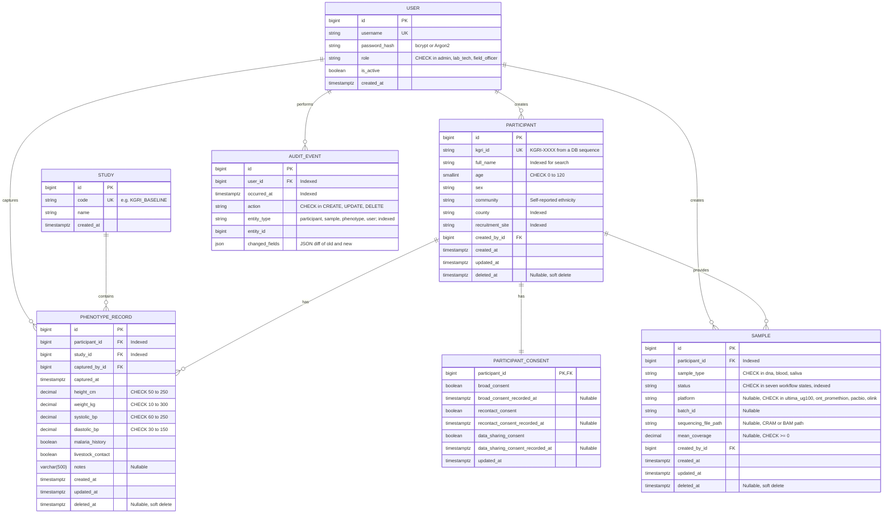

# KGRI database schema

This is the approved seven-table PostgreSQL model. The project owner confirmed supervisor sign-off on 16 November 2026. All timestamps use PostgreSQL `timestamptz` and are handled as timezone-aware UTC values.

[Original diagram](database-schema.png)

## Table descriptions

### USER

Stores the accounts that can sign in to the portal. Each admin, lab technician, or field officer has a unique username, a password hash, and a role. The JWT carries the role. Protected routes check it and return `403` when the role lacks permission. `is_active` lets staff disable an account while keeping its links to participant registrations, sample registrations, phenotype captures, and audit events.

### PARTICIPANT

Stores the person’s name, age, sex, self-reported community, county, and recruitment site. PostgreSQL generates the public `KGRI-XXXX` identifier from a database sequence, and a unique constraint protects it from duplicates. Name, county, and recruitment site are indexed for search and filtering. The internal ID links the participant to their consent, samples, and phenotype records. Setting `deleted_at` hides the participant from active views while preserving those links and the audit history. The API returns `409` if the participant has active samples.

### PARTICIPANT_CONSENT

Stores the participant’s current choices for broad research, recontact for follow-up, and data sharing with named third parties. Each tier has a boolean and its own nullable recorded timestamp. The participant ID is both the primary key and a foreign key, so a participant can have at most one consent row. The separate table supports consent-specific permissions and filters. Toggling a consent flag sets its recorded timestamp and creates a participant `UPDATE` audit event with the changed choice and timestamp in the diff.

### SAMPLE

Tracks a DNA, blood, or saliva sample from collection through lab processing and quality control. Each participant can provide several samples. The database restricts the stored status to the seven workflow states. The API checks each change against the current state and returns `400` with the current and allowed next states for an invalid transition. Platform, batch ID, CRAM/BAM path, and mean coverage are nullable and optional until sequencing. Olink is a proteomics platform, so Olink records leave the CRAM/BAM path and mean coverage empty. The summary endpoint joins to the participant and returns counts by status, platform, and recruitment site.

### STUDY

Stores a name and a unique code for each research study. The pilot seeds one row, `KGRI_BASELINE`. The study foreign key on phenotype records scopes CSV exports and lets the portal associate future records with another study using the same measurement fields.

### PHENOTYPE_RECORD

Stores one capture of height, weight, systolic and diastolic blood pressure, malaria history, livestock contact, and optional notes. Each record links to a participant, a study, and the staff user who captured it, with the date and time of capture. Database checks enforce the measurement ranges shown above. The API reports the field and allowed range for out-of-range values and rejects systolic values less than or equal to diastolic. The CSV export uses the study foreign key and can filter by the participant’s recruitment site.

### AUDIT_EVENT

Stores an append-only history of creates, updates, and deletes on participants, samples, and phenotype records, plus Admin account creation and changes to usernames, roles and active status. Each event records the acting user, timestamp, action, entity type, entity ID, and a JSON diff of the changed fields. A soft delete logs a `DELETE` event, and the mutation and event commit together. Password hashes are excluded from audit diffs. Only admins can view the paginated log through the API, with filters by user, entity type, and date range using the indexed columns.

## Implementation notes

- Both creator relationships correspond to `created_by_id` foreign keys. Study belongs in the phenotypes module.
- An audit target is identified by the pair `entity_type` and `entity_id`.
- Create a participant and its consent row in one transaction.
- Define allowed transitions in one map. The sequence is `collected` → `shipped` → `received_at_lab` → `dna_extracted` → `library_prepped` → `sequenced` → `qc_passed`.
- Apply every schema change through Alembic. The initial migration creates the approved tables, sequence-backed ID function, and append-only audit trigger together before the first audited mutation is exposed.

## Questions for supervisor sign-off

- Which consent boolean defaults should apply before a choice is recorded, and should withdrawal affect existing samples, research use, or future CSV exports?
- Does an active sample mean any sample with `deleted_at` unset? What should happen to linked phenotype records when a participant is soft-deleted?
- Must `KGRI-XXXX` stay exactly four digits? What should the sequence do when it reaches 9999?
- Should `age` mean age at enrolment? Confirm the allowed sex values, string lengths, and measurement precision.
