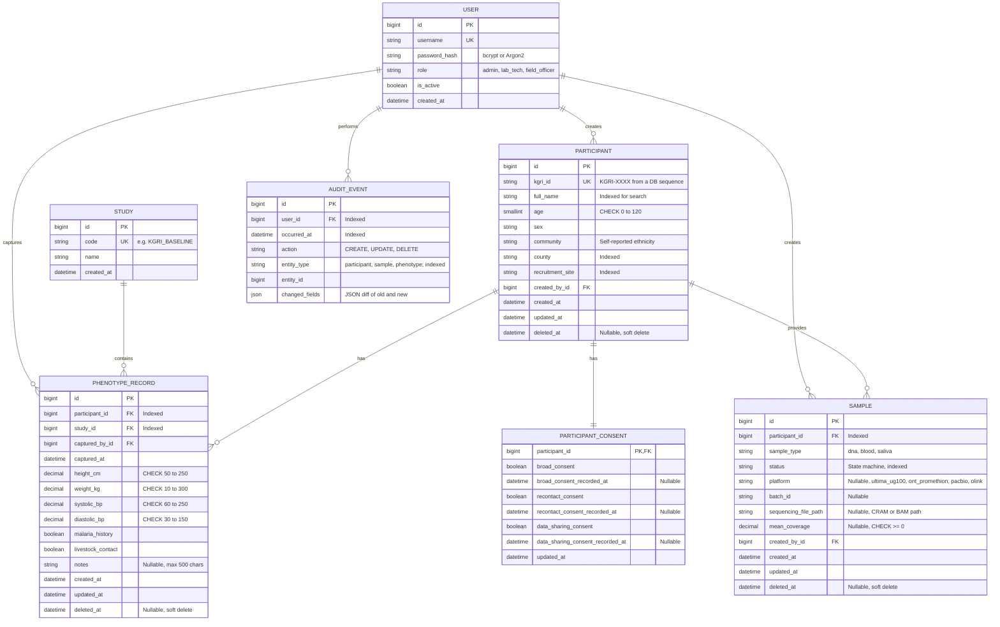

# KGRI database schema

This schema transcribes the diagram supplied by the project owner on 15 November 2026. Supervisor sign-off is pending confirmation.

[Original diagram](database-schema.png)

## Implementation notes

- The two creator relationships make explicit the existing created_by_id foreign keys in the supplied diagram.
- Study belongs in the phenotypes application. Seed KGRI_BASELINE for the pilot.
- AuditEvent uses user_id as supplied. Its entity_id is a polymorphic identifier paired with entity_type. Consent changes are participant UPDATE events.
- Create a participant and its consent row in one transaction. The shared primary key enforces at most one consent row per participant.
- Use PostgreSQL and framework migrations after supervisor sign-off. The existing database/schema.sql describes a different SQLite model and is outside this design.
- Sample transitions follow collected > shipped > received_at_lab > dna_extracted > library_prepped > sequenced > qc_passed. Validate each transition against stored state.
- Write mutation audit events in the same transaction as their record changes.
- Preserve the supplied nullable consent timestamps. Confirm boolean defaults and the meaning of an unrecorded timestamp before implementation.
- Confirm string lengths, decimal precision, allowed sex values, age semantics, identifier behavior above 9999, and deletion behavior for linked records before migrations.
- Django may expose the password hash through its standard password attribute while mapping the database column to password_hash. Final auth model mapping remains an implementation decision.
